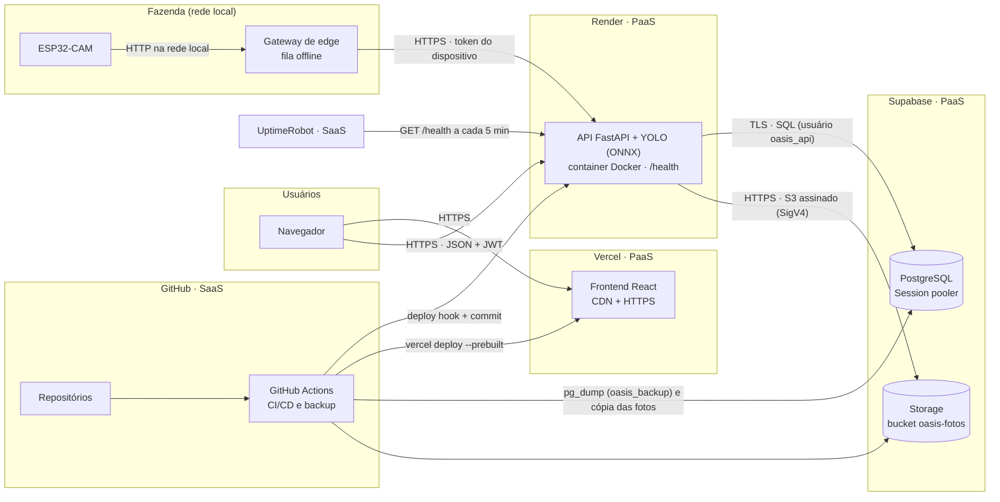

# OASIS na nuvem

Como a OASIS roda em produção: provedores, arquitetura, pipeline, segurança, monitoramento, escalabilidade, custos e o passo a passo para refazer o deploy do zero. Tudo cabe nos planos gratuitos dos provedores.

## 1. Endereços

| O quê | URL |
| --- | --- |
| Sistema (frontend) | variável `OASIS_SITE_URL` do repositório `Vinicola-Front` (ex.: `https://oasis-vinicola.vercel.app`) |
| API | variável `OASIS_API_URL` deste repositório (ex.: `https://oasis-api.onrender.com`) |
| Verificação de saúde | `<URL da API>/health` |
| Execuções do pipeline | aba **Actions** de cada repositório |

## 2. Provedores, serviços e modelo de serviço

| Componente | Provedor e serviço | Modelo | Por que este modelo |
| --- | --- | --- | --- |
| Frontend (React + Vite, arquivos estáticos) | **Vercel**, plano Hobby | PaaS | A Vercel recebe o build pronto e cuida de servidores, CDN global, certificado HTTPS e cache. A equipe não administra máquina nenhuma. |
| Backend (FastAPI + ONNX Runtime, container Docker) | **Render**, Web Service Free | PaaS | O Render roda o nosso `Dockerfile` e entrega HTTPS, verificação de saúde, logs e deploy por hook. Não há sistema operacional nem rede para manter. |
| Banco de dados (PostgreSQL) | **Supabase** Database, plano Free | PaaS (banco gerenciado, DBaaS) | Atualizações, disponibilidade, criptografia em repouso e pooler de conexões são do provedor. A equipe só cria tabelas e papéis. |
| Fotos e miniaturas | **Supabase** Storage, API compatível com S3 | PaaS (armazenamento de objetos gerenciado) | Fotos não cabem no disco do Render grátis, que é apagado a cada reinício. Um bucket privado guarda os arquivos fora do servidor da API. |
| Pipeline de CI/CD e backups | **GitHub Actions** | SaaS | Serviço pronto. A equipe só escreve os workflows em YAML. |
| Monitor externo e alerta | **UptimeRobot** (plano Free) | SaaS | Consulta `/health` de fora a cada 5 min e avisa por e-mail se a API cair. |
| Código e revisão | **GitHub** | SaaS | Repositórios, pull requests, segredos e ambientes. |

Nenhum componente usa IaaS, ou seja, máquinas virtuais administradas pela equipe. A equipe é pequena, o projeto é acadêmico e a meta é custo zero. Com IaaS, a equipe teria de cuidar de atualizações do sistema, firewall, certificados e backups. Mesmo assim, o repositório tem uma alternativa IaaS pronta para um servidor próprio: [`docker-compose.prod.yml`](../docker-compose.prod.yml) com Caddy e HTTPS, descrita em [`docs/producao.md`](producao.md).

**Modelo de implantação: nuvem pública, multicloud.** Os três provedores (Vercel, Render e Supabase) são nuvens públicas. Usamos o melhor plano gratuito de cada um, em vez de concentrar tudo num só:
- o Render não tem banco gratuito permanente (o dele é apagado em 30 dias);
- a Vercel não roda o container da API com o modelo;
- o Supabase não hospeda o backend Python.

O gateway de edge instalado na fazenda é processamento local perto dos sensores (edge computing), não uma nuvem privada. Por isso não chamamos o arranjo de nuvem híbrida.

## 3. Arquitetura



Fluxo de uma foto:
1. A câmera envia a foto ao gateway da fazenda, que descarta capturas escuras ou borradas e reduz o tamanho.
2. O gateway encaminha a foto à API por HTTPS. Se a API demorar ou responder erro 5xx, a foto vai para a fila do gateway e é reenviada depois.
3. A API analisa a foto: o YOLO localiza os cachos e o classificador indica a variedade.
4. A API grava a foto no bucket e o resultado no PostgreSQL.
5. O navegador consulta a API para mostrar a foto e o resultado.

## 4. Pipeline (GitHub Actions)

| Repositório | Workflow | A cada push e pull request | Só na `main`, se tudo passar |
| --- | --- | --- | --- |
| `Vinicola-back` | [`ci-cd.yml`](../.github/workflows/ci-cd.yml) | **Instalação e testes:** `pip install`, checagem de sintaxe e `pytest` (relatório JUnit como artefato). **Build da imagem Docker:** a mesma imagem do Render; o job confere que ela sobe e responde `/health`. **Varredura de segredos:** gitleaks em todo o histórico | **Deploy no Render:** chama o deploy hook com o commit exato e espera `/health` informar esse commit |
| `Vinicola-Front` | `ci-cd.yml` | `npm ci`, testes (Vitest), build (TypeScript + Vite) e varredura de segredos | **Deploy na Vercel:** `vercel pull`, `vercel build --prod`, `vercel deploy --prebuilt --prod` e conferência do site |
| `Vinicola-back` | [`backup.yml`](../.github/workflows/backup.yml) | (agendado, 03h17 de Recife) | `pg_dump` diário e cópia semanal das fotos, criptografados |

O deploy automático dos próprios provedores fica desligado:
- no Render, `autoDeployTrigger: "off"` no `render.yaml`;
- na Vercel, `git.deploymentEnabled: false` no `vercel.json`.

Assim, **só o pipeline publica, e só depois que os testes passam**. O fluxo de trabalho é:
1. abrir uma branch `nome/feat-...`;
2. abrir o pull request, que roda testes, build e varredura;
3. revisar e fazer o merge na `main`, que roda tudo de novo e depois o deploy.

Em **Actions → CI/CD**, o job "Deploy no Render" mostra o commit publicado e o JSON do `/health`.

**Infraestrutura em código:**

| Arquivo | O que descreve |
| --- | --- |
| [`render.yaml`](../render.yaml) | Serviço da API: runtime Docker, plano, região, health check, deploy desligado e todas as variáveis (valores fixos ou marcados como segredo) |
| `Vinicola-Front/vercel.json` | Framework, comandos de instalação e build, rotas da SPA, cabeçalhos de segurança, cache e deploy pelo Git desligado |
| [`Dockerfile`](../Dockerfile) | Imagem da API, com usuário sem privilégios e o modelo dentro da imagem |
| [`deploy/supabase/papeis.sql`](../deploy/supabase/papeis.sql) | Papéis do banco com o mínimo de permissões |
| `.github/workflows/*.yml` | Pipeline e backup |

## 5. Deploy do zero

Faça os passos na ordem. Nenhum segredo vai para o repositório: os valores ficam no Render, na Vercel e nos ambientes do GitHub.

### 5.1 Supabase (banco e fotos)

1. **New project** na região **East US (North Virginia)**, a mesma do Render (`region: virginia`). Guarde a senha do banco num gerenciador de senhas.
2. **SQL Editor:** cole [`deploy/supabase/papeis.sql`](../deploy/supabase/papeis.sql), troque as duas senhas e execute. Isso cria `oasis_api` e `oasis_backup`.
3. **Desligue a Data API**, que a OASIS não usa (Project Settings → Data API). Isso fecha o acesso às tabelas pela chave pública.
4. **Storage → New bucket:** `oasis-fotos`, **privado**.
5. **Storage → S3 Configuration:**
   - ative a conexão S3;
   - copie o **Endpoint** e a **Region**;
   - crie **duas** chaves de acesso: uma para a API e outra para o backup, que podem ser revogadas separadamente.
6. **Connect → Session pooler** (porta 5432, compatível com IPv4). Copie a string e troque o usuário:
   - para a API: `postgresql://oasis_api.<ref>:<senha>@<host-do-pooler>:5432/postgres`;
   - para o backup: o mesmo formato com `oasis_backup.<ref>`.

### 5.2 Render (API)

1. **New → Blueprint** → repositório `Vinicola-back` → branch `main`. O Render lê o `render.yaml` e pede os segredos marcados com `sync: false`:

   | Variável | Valor |
   | --- | --- |
   | `DATABASE_URL` | string do pooler com o usuário `oasis_api` |
   | `S3_ENDPOINT_URL` / `S3_REGION` | valores do passo 5.1.5 |
   | `S3_ACCESS_KEY_ID` / `S3_SECRET_ACCESS_KEY` | chave **da API** |
   | `OASIS_ADMIN_EMAIL` / `OASIS_ADMIN_PASSWORD` | administrador inicial (senha com 12 caracteres ou mais) |
   | `CORS_ORIGINS` | URL do frontend na Vercel (se ainda não existir, use um valor provisório e corrija no passo 5.4) |

2. Ao criar o Blueprint, o Render faz o primeiro deploy. Nos logs, deve aparecer `Imagens: bucket S3 oasis-fotos` e `OASIS API ... pronta`. O teste é `https://<serviço>.onrender.com/health`.
3. No Supabase, rode o bloco final de `papeis.sql`. Ele dá leitura ao backup e fecha a Data API nas tabelas recém-criadas.
4. Em **Settings → Deploy Hook**, copie a URL. Ela é secreta.

### 5.3 GitHub (`Vinicola-back`)

Em **Settings → Environments**, crie os ambientes abaixo. Em **Deployment branches**, deixe `producao` só para `main`.

| Ambiente | Tipo | Nome | Valor |
| --- | --- | --- | --- |
| `producao` | secret | `RENDER_DEPLOY_HOOK_URL` | URL do deploy hook |
| `producao` | variável | `OASIS_API_URL` | `https://<serviço>.onrender.com` |
| `backup` | secret | `OASIS_BACKUP_DATABASE_URL` | string do pooler com o usuário `oasis_backup` |
| `backup` | secret | `OASIS_BACKUP_PASSPHRASE` | senha longa para criptografar os backups (guarde fora do GitHub) |
| `backup` | secrets | `OASIS_BACKUP_S3_ENDPOINT_URL`, `OASIS_BACKUP_S3_REGION`, `OASIS_BACKUP_S3_ACCESS_KEY_ID`, `OASIS_BACKUP_S3_SECRET_ACCESS_KEY` | chave **do backup** |

Para testar o backup, use **Actions → Backup → Run workflow**.

### 5.4 Vercel (frontend)

1. **Add New → Project** → repositório `Vinicola-Front`. O preset Vite e os comandos vêm do `vercel.json`.
2. Em **Settings → Environment Variables (Production)**, defina `VITE_API_URL` = `https://<serviço>.onrender.com`.
3. Em **Account Settings → Tokens**, crie um token com escopo só do time do projeto e com data de validade. Os IDs ficam em **Project Settings → General**: *Project ID*, e no time, *Team ID*.
4. No GitHub do `Vinicola-Front`, crie o ambiente `producao` (só `main`) com:
   - secrets `VERCEL_TOKEN`, `VERCEL_ORG_ID` (Team ID) e `VERCEL_PROJECT_ID`;
   - variável `OASIS_SITE_URL` (`https://<projeto>.vercel.app`).
5. No Render, ajuste `CORS_ORIGINS` para a URL da Vercel. Alterar uma variável reinicia o serviço com o mesmo commit.

### 5.5 Monitor e primeiro teste

1. No UptimeRobot, crie um monitor **HTTP(s)** em `https://<serviço>.onrender.com/health`, intervalo de 5 min, com alerta por e-mail. Esse acesso periódico também evita que o Render hiberne (15 min sem acesso) e conta como atividade no banco do Supabase, que pausa projetos parados por 7 dias.
2. Faça um merge pequeno na `main` de cada repositório e acompanhe em **Actions**.
3. Entre no sistema, cadastre um sensor e envie uma foto.
4. Confira:
   - em **Administração → Sistema**: "bucket de objetos (S3)";
   - em **Administração → Auditoria**: o seu IP público no login, e não um IP interno `10.x`.

## 6. Variáveis de ambiente

Desenvolvimento e produção usam o mesmo código e mudam só as variáveis. Os modelos sem valores reais estão em [`.env.example`](../.env.example) e em `Vinicola-Front/.env.example`.

| Variável | Desenvolvimento (`.env` local) | Produção (Render) |
| --- | --- | --- |
| `ENVIRONMENT` | `development` (aceita segredo padrão, `/docs` ligado) | `production` (recusa configuração insegura, `/docs` desligado) |
| `DATABASE_URL` | `sqlite:///./oasis.db` | Supabase, usuário `oasis_api` (segredo) |
| `JWT_SECRET` | vazio (segredo de desenvolvimento) | gerado pelo Render |
| `STORAGE_BACKEND` | `local` (pasta `storage/`) | `s3` |
| `S3_*` | vazios | Supabase Storage (segredos) |
| `OASIS_ADMIN_EMAIL` / `OASIS_ADMIN_PASSWORD` | opcionais | segredos |
| `CORS_ORIGINS` | `http://localhost:5173` | URL HTTPS da Vercel |
| `CLIENT_IP_HEADER` | vazio | `true-client-ip,cf-connecting-ip` |
| `OASIS_MAX_CONCURRENT_ANALYSES` | `2` | `1` (512 MB de memória) |
| `DB_POOL_SIZE` / `DB_MAX_OVERFLOW` | `10` / `20` | `3` / `2` |
| `VITE_API_URL` (frontend) | vazio (o Vite encaminha `/api` para a API local) | URL HTTPS da API |

## 7. Dados e backups

- **Banco:** PostgreSQL gerenciado no Supabase. A API cria as tabelas na primeira inicialização e adiciona colunas novas sozinha.
- **Fotos:** bucket privado `oasis-fotos`. A API grava e lê pela API S3, com requisições assinadas. O navegador nunca acessa o bucket, só a API, que confere o login.
- **Backups:**
  - o plano gratuito do Supabase não garante cópias restauráveis, então o workflow `backup.yml` faz backups fora do provedor;
  - todo dia faz `pg_dump` com o usuário somente leitura `oasis_backup`; aos domingos copia todas as fotos;
  - os arquivos são **criptografados com GPG (AES-256)** antes de virar artefato do GitHub, guardado por 30 dias. O repositório é público e qualquer pessoa logada no GitHub pode baixar artefatos, mas sem a senha eles não servem para nada.
- **Restauração:**
  ```bash
  gpg --decrypt oasis-banco-AAAAMMDD-HHMM.dump.gpg > banco.dump     # pede OASIS_BACKUP_PASSPHRASE
  pg_restore --no-owner --no-privileges -d "<URL de um banco vazio>" banco.dump
  # o único aviso esperado é "schema public already exists"
  gpg --decrypt oasis-fotos-AAAAMMDD-HHMM.tar.gz.gpg | tar -xz -C fotos/
  ```
  Esse caminho foi testado: backup com o papel somente leitura, criptografia, descriptografia e restauração com todos os registros.
- Para copiar as fotos à mão, rode `python -m app.cli baixar-fotos --out backups/fotos` com as variáveis `S3_*`.

## 8. Segredos e menor privilégio

| Quem | Acesso | Não consegue |
| --- | --- | --- |
| API (`oasis_api`) | criar e alterar as próprias tabelas no schema `public` | ler `auth`, `storage` ou outros schemas do Supabase; criar papéis; passar de 10 conexões |
| Backup (`oasis_backup`) | `SELECT` nas tabelas da OASIS | inserir, alterar ou apagar dados |
| Data API do Supabase (`anon`, `authenticated`) | nada: desligada, e permissões revogadas nas tabelas | ler usuários, sensores ou leituras com a chave pública |
| Chaves S3 | uma da API e outra do backup | ser revogadas juntas: cada uma é trocada sem afetar a outra |
| Workflows do GitHub | `permissions: contents: read` | alterar o repositório |
| Deploy hook e token da Vercel | ambiente `producao`, liberado só para a `main` | ser lidos por jobs de pull request ou de outras branches |
| Token da Vercel | escopo do time do projeto, com validade | acessar outros times |
| Usuários do sistema | perfis `admin`, `gestor` e `operador`, conferidos no servidor | agir fora do perfil |
| Sensores | token próprio, guardado só como hash | enviar em nome de outro sensor |

Esses limites foram testados num PostgreSQL com os mesmos papéis antes da publicação. Por exemplo, o backup não consegue apagar leituras, a API não consegue ler `auth.users` e o papel `anon` não lê a tabela de usuários.

Os segredos ficam só no painel do Render, na Vercel e nos ambientes do GitHub. O pipeline roda o **gitleaks em todo o histórico** a cada push e falha se encontrar credenciais. As exceções revisadas, todas valores fictícios de testes e exemplos, estão em [`.gitleaks.toml`](../.gitleaks.toml). Se uma chave vazar, é preciso **revogá-la na hora** no provedor (apagar o commit não basta), cadastrar a nova no painel e refazer o deploy.

## 9. Monitoramento e logs

| O quê | Onde |
| --- | --- |
| Saúde da API e do banco | `GET /health` responde `{"status":"ok","database":"ok","version":...,"commit":...}` ou **503** se o banco cair |
| Health check do provedor | o Render consulta `/health` (`healthCheckPath`). Uma versão nova só substitui a antiga se responder 200 |
| Alerta | UptimeRobot, a cada 5 min, com e-mail quando cai e quando volta |
| Logs da API | Render → serviço → **Logs**: inicialização, detector carregado, bucket acessível, cada leitura gravada, erros com stack trace |
| Logs do frontend | Vercel → projeto → **Deployments** (build) e **Logs** |
| Logs do banco e do bucket | Supabase → **Logs & Analytics** (Postgres, Pooler, Storage) |
| Pipeline e backups | GitHub → **Actions** (o histórico de execuções faz parte da avaliação: não apagar) |
| Auditoria de negócio | Administração → Auditoria: logins, alterações, importações, com IP |

## 10. Escalabilidade e limites atuais

Limites do plano gratuito, medidos numa simulação com 0,1 CPU e 512 MB:

| Medida | Valor |
| --- | --- |
| Inicialização da API | cerca de 20 s |
| Análise de uma foto de celular (12 MP) | cerca de 8 s |
| Memória com uma análise rodando | cerca de 260 MB |
| Fotos simultâneas | entram numa **fila** e são analisadas uma por vez |
| Espera máxima na fila | 60 s; depois disso a API responde 503 e o gateway reenvia |
| Banco | 500 MB |
| Fotos | 1 GB, cerca de 2.500 leituras |
| Hibernação | o Render hiberna após 15 min sem acesso; o monitor evita isso dentro das 750 h grátis do mês |

Se o número de usuários e câmeras aumentar:
- **Vertical:**
  - no Render, trocar `plan: free` por `starter` (0,5 CPU) ou `standard` (1 CPU, 2 GB) no `render.yaml` e subir `OASIS_MAX_CONCURRENT_ANALYSES` para 3 ou 4;
  - no Supabase, plano Pro (8 GB de banco, 100 GB de arquivos) e computação maior.
- **Horizontal:**
  - a API não guarda estado em disco, porque as fotos estão no bucket e os dados no banco. Por isso pode rodar com várias instâncias (`numInstances` nos planos pagos) atrás do balanceador do Render;
  - com o workspace Professional, o Render faz **autoscaling** por CPU e memória;
  - antes disso, o bloqueio de login e o limite de consultas, que hoje ficam na memória de cada instância, precisam ir para um armazenamento compartilhado (Render Key Value/Redis).
- **Automática:** a Vercel já escala o frontend sozinha (CDN), e o pooler do Supabase distribui as conexões.

## 11. Custos

Para estimar o custo, definimos dois cenários de uso:

| Premissa | Uso atual (piloto) | 10× mais usuários |
| --- | --- | --- |
| Usuários do painel | 5 | 50 |
| Câmeras | 3 | 30 |
| Fotos por mês (9 por câmera por dia) | cerca de 810 | cerca de 8.100 |
| Espaço novo em fotos por mês (cerca de 0,4 MB por leitura) | cerca de 0,33 GB | cerca de 3,3 GB |
| Banco | menos de 50 MB | cerca de 300 MB por ano |
| Banda de saída da API (fotos e miniaturas vistas no painel) | cerca de 0,5 GB | cerca de 18 GB |

Custo de cada serviço nos dois cenários:

| Serviço | Uso atual | 10× mais usuários |
| --- | --- | --- |
| Vercel (frontend) | Hobby: **US$ 0** (100 GB de banda) | Hobby: **US$ 0** (uso não comercial). Se virar produto, Pro: US$ 20 por membro |
| Render (API) | Workspace Hobby + instância Free: **US$ 0** (5 GB de banda inclusos) | Workspace Hobby + instância **Standard: US$ 25** (1 CPU e 2 GB, para analisar 3 ou 4 fotos ao mesmo tempo) + banda excedente de cerca de 13 GB × US$ 0,15 = **cerca de US$ 2** |
| Supabase (banco e fotos) | Free: **US$ 0** | **Pro: US$ 25** (8 GB de banco, 100 GB de arquivos e backups diários; inclui US$ 10 de crédito de computação) |
| GitHub Actions | **US$ 0** (repositório público) | **US$ 0** |
| UptimeRobot | **US$ 0** | **US$ 0** |
| **Total por mês** | **US$ 0** | **cerca de US$ 52** |

Os valores vêm das páginas de preço e das calculadoras dos provedores, consultadas em novembro de 2026: [Render](https://render.com/pricing), [Supabase](https://supabase.com/pricing) e [Vercel](https://vercel.com/pricing). O relatório traz as capturas de tela. No cenário atual, o limite que chega primeiro é o 1 GB de fotos do Supabase, em cerca de 3 meses.

## 12. Dificuldades encontradas

| Problema | Solução |
| --- | --- |
| A API caía por falta de memória com duas fotos de celular ao mesmo tempo (512 MB) | Foto aberta já reduzida e fila de análises |
| O disco do Render grátis é apagado a cada reinício | Fotos no Supabase Storage pela API S3, com cliente leve próprio em vez do boto3, para economizar memória |
| O banco grátis do Render é apagado em 30 dias | Banco no Supabase |
| O Supabase exige IPv4 pelo pooler | `DATABASE_URL` pelo Session pooler (porta 5432) |
| O IP de todos os acessos chegava como o do proxy do Render, e cinco senhas erradas de qualquer pessoa bloqueariam todos | `CLIENT_IP_HEADER` lê o cabeçalho que o proxy do Render sobrescreve |
| Os artefatos do GitHub são públicos em repositório público | Backups criptografados com GPG antes do upload |
