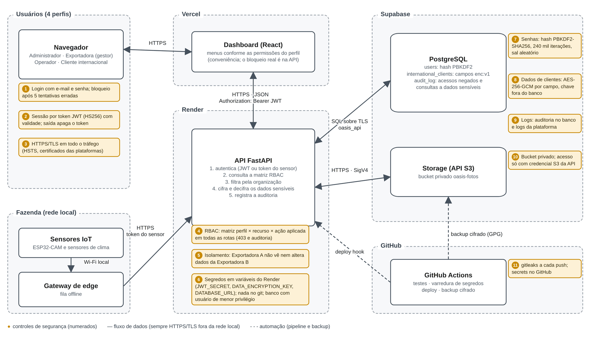
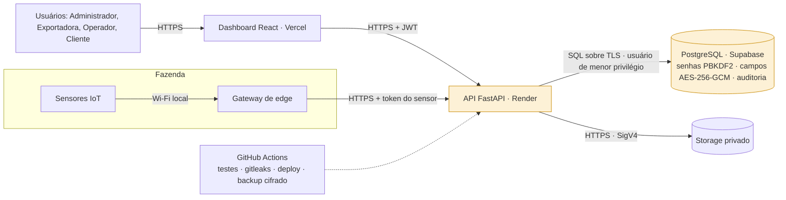

# Segurança da Informação na OASIS

Este documento descreve os controles de segurança do **Dashboard de Monitoramento Climático e Logístico em Nuvem para Exportadoras de Frutas**: autenticação, autorização por perfil (RBAC) com isolamento entre exportadoras, proteção das senhas, criptografia dos dados sensíveis e gestão de segredos. Cada controle aponta para o código que o implementa e para o teste automatizado que o comprova.

| Item | Onde está | Como comprovar |
| --- | --- | --- |
| 1. Matriz RBAC | `app/rbac.py` (`MATRIX`), `GET /api/v1/auth/matrix`, aba **Administração → Permissões** | `python -m app.cli matriz-rbac` |
| 2. RBAC funcional e isolamento | `require()`, `tenant()` e `check_organization()` em `app/rbac.py`, aplicados em todas as rotas | `tests/test_seguranca.py` |
| 3. Autenticação | `app/routers/auth.py`, `app/deps.py`, `app/security.py` | login válido, inválido e rota sem sessão |
| 4. Senhas com hash | `hash_secret()` em `app/security.py` (PBKDF2-SHA256) | `SELECT email, password_hash FROM users` |
| 5. Dados sensíveis cifrados | `app/crypto.py` (AES-256-GCM), `app/routers/clients.py` | `SELECT email_enc FROM international_clients` |
| 6. Gestão de segredos | `.env.example`, `.gitignore`, `render.yaml`, `.gitleaks.toml` | varredura do gitleaks no pipeline |
| 7. Arquitetura de segurança | diagrama abaixo | — |
| 8. Testes de segurança | `tests/test_seguranca.py` (41 testes) | `python -m pytest tests/test_seguranca.py -v` |

## 1. Perfis e matriz de permissões

Os quatro perfis pedidos foram adaptados aos papéis do sistema:

| Perfil pedido | Perfil na OASIS (`role`) | Quem é |
| --- | --- | --- |
| Administrador | Administrador (`admin`) | Equipe que mantém a plataforma. Não pertence a uma exportadora e vê todas. |
| Exportadora | Exportadora, gestor (`gestor`) | Responsável pela exportadora: sensores, clientes, importações e indicadores da própria empresa. |
| Operador Logístico | Operador de campo e logística (`operador`) | Envia fotos e medições e acompanha o monitoramento da própria exportadora. Não vê dados comerciais. |
| Cliente Internacional | Cliente internacional (`cliente`) | Importador. Consulta só leitura dos indicadores da exportadora que o atende e o próprio cadastro. |

A matriz abaixo é gerada pelo próprio código (`python -m app.cli matriz-rbac`). É a mesma tabela que as rotas consultam, que a API publica em `/auth/matrix` e que o painel mostra na aba **Permissões**. Por isso, documentação e comportamento não divergem.

| Recurso | Administrador | Exportadora (gestor) | Operador de campo e logística | Cliente internacional |
| --- | --- | --- | --- | --- |
| Usuários | CRUD | – | – | – |
| Organizações (exportadoras) | CRUD | R (própria) | R (própria) | R (própria) |
| Sensores IoT | CRUD | CRUD (própria organização) | R (própria organização) | – |
| Análises de qualidade (fotos, histórico e indicadores) | CRD | CRD (própria organização) | CR (própria organização) | R (exportadora contratada) |
| Dados climáticos (temperatura, umidade, luz, solo) | CR | CR (própria organização) | CR (própria organização) | R (exportadora contratada) |
| Importação de dados | CR | CR (própria organização) | – | – |
| Clientes internacionais (dados sensíveis cifrados) | CRUD | CRUD (própria organização) | – | R (somente o próprio cadastro) |
| Auditoria | R | – | – | – |
| Configurações e estado do sistema | R | – | – | – |

C = criar · R = consultar · U = atualizar · D = excluir · – = sem acesso

## 2. Como o RBAC é aplicado

A autorização acontece **no backend**, em toda requisição. O painel só esconde menus por conveniência (`canAccess` em `src/services/api.ts` lê as permissões que a API devolve em `/auth/me`). Uma chamada direta à API, sem passar pela interface, recebe a mesma resposta.

1. **Perfil × recurso × ação.** Cada rota declara o que exige, por exemplo `Depends(require("clientes", "R"))`. Se o perfil não tem a letra na matriz, a API responde **403** com a mensagem `Acesso negado: o perfil Operador de campo e logística não pode consultar clientes internacionais.` e grava `acesso_negado` na auditoria. Sem sessão, a resposta é **401**.
2. **Organização.** Cada usuário (exceto o administrador), sensor, leitura, importação e cliente pertence a uma organização. As listagens são filtradas pela organização do usuário (`tenant(user)`), e o acesso a um registro específico de outra organização responde **403** `Acesso negado: este registro pertence a outra organização.`, também auditado.
3. **Cliente internacional.** Além da organização, só enxerga o cadastro ligado a ele (`users.client_id`).

O perfil e a organização são lidos do banco a cada requisição, não do token. Um usuário rebaixado ou desativado perde o acesso na hora.

### Situações exigidas

| Situação | Exemplo real (demonstração) | Resultado |
| --- | --- | --- |
| 1. Acesso autorizado | `gestor@valedosol.example` abre **Clientes internacionais** | 200, lista da própria exportadora |
| 2. Acesso não autorizado | `operador@valedosol.example` chama `GET /clients` | 403 “Acesso negado: o perfil Operador… não pode consultar clientes internacionais.” |
| 3. Isolamento entre organizações | `gestor@valedosol.example` chama `GET /readings/OA-00002` (análise da Exportadora Rio Verde) | 403 “Acesso negado: este registro pertence a outra organização.” |

O teste `test_exportadora_A_nao_acessa_dados_da_exportadora_B` repete a situação 3 em sete rotas: leitura, sensor, medições, cliente (consulta e alteração), exclusão e envio de foto. O teste `test_cadastro_e_envio_nao_cruzam_organizacoes` cobre o cadastro de sensor em outra organização e o envio de foto por um sensor alheio.

## 3. Autenticação

- **Login** em `POST /api/v1/auth/login` com e-mail e senha. A resposta traz um **JWT** (HS256, assinado com `JWT_SECRET`, validade de 8 horas) e o perfil com as permissões.
- **Login inválido** responde 401 `E-mail ou senha inválidos.`, sem revelar se o e-mail existe. Após **5 tentativas erradas** do mesmo e-mail e IP, o login fica bloqueado por 15 minutos (429). As falhas e os bloqueios vão para a auditoria.
- **Sessão.** O painel envia o token em `Authorization: Bearer` e volta para o login quando a API responde 401 (token expirado, adulterado ou usuário desativado). Sair apaga o token do navegador.
- **Rotas protegidas.** Tudo exige sessão, exceto `/health`, `/public/*` (resumo sem localização) e o envio das câmeras, que usa o token próprio de cada sensor (aleatório, 192 bits, guardado só como hash).
- Política de senha: mínimo de 8 caracteres, com letras e números. Em produção, a senha do administrador inicial precisa de 12 ou mais caracteres.

## 4. Proteção das senhas

As senhas são guardadas com **PBKDF2-HMAC-SHA256, 240 mil iterações e sal aleatório de 16 bytes** por usuário (`app/security.py`). O formato gravado é `pbkdf2_sha256$<iterações>$<sal>$<hash>`:

```
          email              |   role   |                              password_hash
-----------------------------+----------+-------------------------------------------------------------------------------------------
 gestor@valedosol.example    | gestor   | pbkdf2_sha256$240000$UE3gmsgyHjjXfSvVcggW6g==$0w0mys17Vdc8DMu7xGYAHIC/WaM0XLGhs4c1h55qT74=
 operador@valedosol.example  | operador | pbkdf2_sha256$240000$JHqhwYi+NQ81yu0wGJVtiA==$2Yo5aetxE174Z8I9bYfEIjInz7TabW1FAQlI7PUQddI=
```

Os três usuários têm a mesma senha e hashes diferentes, por causa do sal. A comparação usa `hmac.compare_digest` (tempo constante). PBKDF2 é recomendado pelo NIST SP 800-132 e está na biblioteca padrão do Python, sem dependência extra.

## 5. Dados sensíveis

| Dado | Onde | Classificação | Proteção |
| --- | --- | --- | --- |
| Senhas | `users.password_hash` | Credencial | Hash PBKDF2 (irreversível) |
| Tokens dos sensores | `sensors.device_token_hash` | Credencial | Hash SHA-256; exibido uma única vez |
| Contato, e-mail, telefone e identificação fiscal do cliente internacional | `international_clients.*_enc` | Dado pessoal (LGPD/GDPR) | AES-256-GCM por campo |
| Condições comerciais (volume, preço, Incoterm, pagamento) | `international_clients.commercial_terms_enc` | Segredo comercial | AES-256-GCM por campo |
| Coordenadas dos talhões | `sensors.lat/lng` | Dado da propriedade | Só para usuários da exportadora; fora do resumo público |
| Fotos e indicadores de qualidade | bucket `oasis-fotos`, `readings` | Dado operacional | Bucket privado; isolamento por organização |
| Chaves e senhas de serviços | variáveis de ambiente | Segredo | Fora do código (seção 7) |

Nome da empresa e país do cliente ficam em claro: são usados em busca e ordenação e não identificam uma pessoa.

## 6. Criptografia

### Em trânsito

Todo tráfego fora da rede da fazenda usa **HTTPS/TLS**: navegador ↔ Vercel, painel ↔ API no Render, gateway ↔ API, API ↔ PostgreSQL (TLS do pooler do Supabase) e API ↔ Storage (HTTPS com assinatura SigV4). Sob HTTPS, a API envia `Strict-Transport-Security`. Os certificados são emitidos e renovados pelas plataformas.

### Em repouso, por campo (aplicação)

`app/crypto.py` cifra cada campo sensível com **AES-256-GCM**, que também autentica o valor: uma alteração no banco faz a leitura falhar.

```
enc:v1:<id da chave>:<nonce de 96 bits>:<texto cifrado + tag de 128 bits>
```

- Um nonce aleatório por valor: o mesmo e-mail cifrado duas vezes gera valores diferentes.
- Dado associado (AAD) `oasis:international_clients.<campo>:org=<id>`: um valor copiado para outro campo ou outra exportadora não decifra.
- A chave (`DATA_ENCRYPTION_KEY`, 32 bytes em base64) fica só em variável de ambiente, nunca no banco nem no código. Em produção, a API não sobe sem uma chave válida ou com a chave de desenvolvimento.
- **Troca de chave:** a chave nova vai para `DATA_ENCRYPTION_KEY` e a antiga para `DATA_ENCRYPTION_OLD_KEYS`. Depois, `python -m app.cli recifrar-dados` recifra os cadastros com a chave nova, e a antiga pode ser removida.

Além disso, o Supabase cifra o disco do banco e do Storage (AES-256), e os backups enviados ao GitHub são cifrados com GPG antes do envio.

### Fluxo demonstrado

1. **Original:** o gestor cadastra o cliente com o e-mail `erik.lindqvist@nordicfresh.example`.
2. **Criptografia:** a API cifra o valor antes do `INSERT`.
3. **Armazenado:** o banco guarda `enc:v1:42cdf973:A0XqXSaoNWA3EUJ2:r3cU67xfx9MefQ3RB…`. Uma busca por `%nordicfresh%` no banco não encontra nada.
4. **Usuário autorizado:** o gestor da mesma exportadora abre **Ver dados** (`GET /clients/1`). A consulta é registrada na auditoria (`dados_sensiveis_consultados`).
5. **Descriptografia:** a API decifra com a chave e o contexto da exportadora.
6. **Apresentado:** o painel mostra o e-mail completo. Na listagem, os valores aparecem mascarados (`er•••@nordicfresh.example`), e o operador nem chega a recebê-los (403).

## 7. Gestão de segredos

| Segredo | Desenvolvimento | Produção |
| --- | --- | --- |
| `JWT_SECRET` | `.env` local | Gerado pelo Render (`generateValue: true`) |
| `DATA_ENCRYPTION_KEY` | `.env` local (vazia = chave de desenvolvimento) | Gerada pelo Render (`generateValue: true`) |
| `DATABASE_URL` | `.env` local | Painel do Render (`sync: false`) |
| `S3_ACCESS_KEY_ID` / `S3_SECRET_ACCESS_KEY` | `.env` local | Painel do Render (`sync: false`) |
| `OASIS_ADMIN_PASSWORD` | `.env` local | Painel do Render (`sync: false`) |
| `RENDER_DEPLOY_HOOK_URL`, `VERCEL_TOKEN`, `BACKUP_DATABASE_URL`, `BACKUP_PASSPHRASE` | — | Secrets dos ambientes `producao` e `backup` do GitHub |

- `.env` está no `.gitignore`. Só o modelo `.env.example`, com nomes e sem valores, é versionado.
- O pipeline roda o **gitleaks** em todo o histórico a cada push. Um segredo commitado reprova o build.
- `python -m app.cli check-config` recusa configuração de produção insegura: chave de desenvolvimento, `JWT_SECRET` curto, senha de administrador fraca ou S3 incompleto.
- **Guarde uma cópia de `DATA_ENCRYPTION_KEY`** num gerenciador de senhas da equipe. Sem ela, os dados cifrados não podem ser recuperados, nem a partir do backup.

## 8. Arquitetura de segurança





Controles por camada:

| Camada | Controles |
| --- | --- |
| Usuário e navegador | Login, bloqueio por tentativas, sessão JWT com validade, HTTPS |
| Dashboard | Menus conforme as permissões; Content-Security-Policy e cabeçalhos de segurança (`vercel.json`) |
| API | Autenticação, matriz RBAC em todas as rotas, isolamento por organização, cifra e decifra de dados sensíveis, auditoria, CORS restrito, limites de tamanho e de tentativas |
| Banco e Storage | Senhas com hash, campos cifrados, usuário `oasis_api` com menor privilégio, bucket privado, TLS |
| Sensores | Token individual por dispositivo, guardado como hash; HTTPS do gateway à API |
| Pipeline | Testes de segurança, gitleaks, secrets do GitHub, backup cifrado |
| Logs | `audit_log` (logins, falhas, bloqueios, acessos negados, consultas a dados sensíveis, alterações) e logs da plataforma |

## 9. Testes de segurança

`tests/test_seguranca.py` monta duas exportadoras (A e B) com usuários de cada perfil e roda 41 testes. Os principais:

| Teste | Resultado esperado | Resultado obtido | Evidência |
| --- | --- | --- | --- |
| Login com credenciais válidas | 200, token JWT, perfil, organização e permissões | 200 com token e permissões | `test_login_valido_cria_sessao_com_perfil_organizacao_e_permissoes` |
| Login com senha errada | 401 sem revelar se o e-mail existe; falha auditada | 401 “E-mail ou senha inválidos.” | `test_login_invalido_e_rotas_protegidas_sem_sessao` |
| Rota protegida sem sessão ou com token adulterado | 401 | 401 | idem |
| Cada perfil × cada recurso | Resposta conforme a matriz (200 ou 403) | 24 combinações conforme a matriz | `test_consulta_de_cada_recurso_segue_a_matriz` |
| Operador consulta clientes internacionais | 403 e registro `acesso_negado` | 403 e +1 na auditoria | `test_acesso_permitido_e_negado_por_perfil_com_auditoria` |
| Exportadora A acessa dados da Exportadora B | 403 em todas as rotas | 403 em 7 rotas | `test_exportadora_A_nao_acessa_dados_da_exportadora_B` |
| Cliente internacional abre outro cadastro | 403 | 403 | `test_cliente_internacional_so_ve_o_proprio_cadastro` |
| Senha no banco | Hash PBKDF2 com sal; senha em texto ausente | Hashes diferentes para a mesma senha | `test_senha_armazenada_como_hash_pbkdf2_com_sal` |
| Dado sensível no banco | Só `enc:v1:…`; detalhe decifrado para quem pode | Cifrado no banco, mascarado na lista, decifrado no detalhe | `test_dados_do_cliente_internacional_ficam_cifrados_no_banco` |
| Valor cifrado adulterado ou movido de campo | Leitura falha | `DecryptionError` | `test_cifra_autenticada_com_contexto_e_nonce_aleatorio` |
| Troca da chave de criptografia | Dados antigos legíveis; após recifrar, a chave antiga sai | Legíveis com a chave nova | `test_recifrar_dados_conclui_a_troca_de_chave` |
| Segredos no repositório | Nenhum `.env`, `.pem` ou `.key` versionado | Nenhum | `test_nenhum_arquivo_de_segredos_versionado` e gitleaks |

```bash
python -m pytest tests/test_seguranca.py -v
```

## 10. Roteiro da demonstração

Preparação, uma vez por ambiente:

```bash
python -m app.cli demo-seguranca --senha <senha-de-demonstração>
```

O comando cria as exportadoras **Vale do Sol** (Petrolina) e **Rio Verde** (Juazeiro), um gestor, um operador e um cliente em cada (`gestor@valedosol.example`, `operador@valedosol.example`, `cliente@valedosol.example` e os equivalentes em `rioverde.example`) e um cliente internacional com os dados cifrados. Empresas, pessoas e contatos são fictícios. No Render gratuito não há terminal: rode o comando na sua máquina com `DATABASE_URL` e `DATA_ENCRYPTION_KEY` iguais aos de produção (painel do Render → Environment) e não salve esses valores em arquivo versionado.

Sequência da apresentação:

1. **Login** como `gestor@valedosol.example`. Mostrar também uma senha errada: “E-mail ou senha inválidos.”
2. **Perfil A, acesso permitido:** menu **Clientes internacionais**, com a lista mascarada. Em **Ver dados**, os dados aparecem decifrados.
3. **Perfil B, acesso negado:** sair e entrar como `operador@valedosol.example`. O menu de clientes não aparece. Abrir `/clientes` direto ou chamar `GET /api/v1/clients` com o token do operador: 403.
4. **Isolamento:** como gestor da Vale do Sol, abrir `/historico/OA-00002` (análise da Rio Verde): “Acesso negado: este registro pertence a outra organização.”
5. **Banco de dados, senha protegida:** `SELECT email, password_hash FROM users;`
6. **Dado sensível criptografado:** `SELECT company_name, email_enc FROM international_clients;`
7. **Auditoria:** como administrador, **Administração → Auditoria → Acessos negados**.
8. **Arquitetura:** diagrama da seção 8.

## Limitações conhecidas

- O JWT não é revogado antes de expirar. Desativar o usuário ou trocar o perfil vale na hora, porque a API consulta o banco a cada requisição, mas um token roubado continua válido por até 8 horas para um usuário ativo.
- O token fica no `localStorage` do navegador. A Content-Security-Policy do site (`vercel.json`, sem script inline nem de outras origens) reduz o risco de XSS, mas um cookie `HttpOnly` seria mais forte.
- O OWASP sugere hoje 600 mil iterações para PBKDF2-SHA256. Mantivemos 240 mil por causa da CPU reduzida do plano gratuito. O número de iterações fica gravado em cada hash, então pode ser aumentado sem invalidar as senhas existentes.
- O bloqueio de login fica na memória do processo. Com várias instâncias, precisaria de um Redis.
- A busca não alcança campos cifrados (e-mail, telefone). Isso é intencional, porque buscar exigiria um índice derivado do dado.
